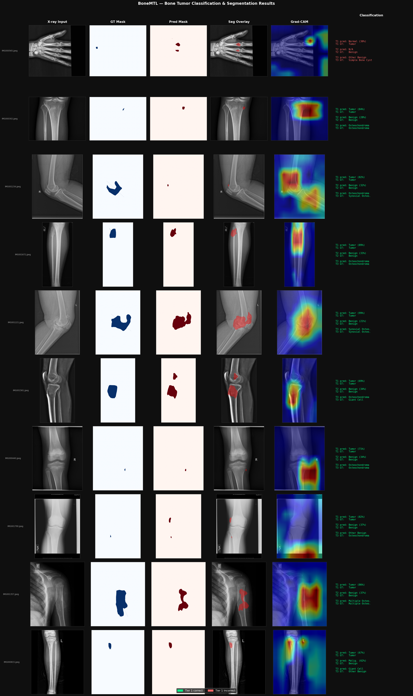

# BoneMTL

[](https://python.org)
[](https://pytorch.org)
[](https://developer.nvidia.com/cuda-toolkit)

**Multitask Deep Learning for Classification and Segmentation of Bone Tumors in X-ray Images**

BoneMTL is a multitask learning framework that jointly performs pixel-level tumor segmentation and three-tier hierarchical classification (tumor detection, benign vs. malignant, 9 tumor types) on bone X-ray images from the BTXRD dataset.

This is a research project, not a medical device, and must not be used for clinical decisions.

---

## Results

### Test set

Single training run, SWA weights (`swa.pth`), evaluated on the held-out test split (535 images, 267 with a tumor). Training stopped early at epoch 70, so SWA averaged epochs 60 to 70.

| Task | Metric | Score |
|------|--------|-------|
| Segmentation | Dice | **0.5621** |
| Segmentation | IoU | **0.4531** |
| Tier 1 (tumor detection) | F1 | **0.8410** |
| Tier 1 | AUC | **0.9279** |
| Tier 1 | Accuracy | **0.8523** |
| Tier 2 (benign / malignant) | F1 | **0.7523** |
| Tier 2 | AUC | **0.9425** |
| Tier 2 | Accuracy | **0.8989** |
| Tier 3 (9 tumor types) | F1 macro | **0.4890** |
| Tier 3 | Accuracy | **0.6367** |

Segmentation is evaluated on images that have a mask. Tier 2 and Tier 3 are evaluated on tumor images only.

Comparison with the other checkpoint and post-processing options from `evaluate.py`:

| Weights / post-processing | Dice | Tier 1 AUC | Tier 2 AUC | Tier 3 Acc | Tier 3 F1 macro |
|---------------------------|------|-----------|-----------|-----------|-----------------|
| `best.pth` (epoch 60) | 0.5630 | 0.9162 | 0.9372 | 0.6292 | 0.4891 |
| `best.pth` + TTA (5 views) | 0.5503 | 0.9264 | 0.9359 | 0.6517 | 0.5027 |
| `best.pth` + CRF | 0.5145 | 0.9162 | 0.9372 | 0.6292 | 0.4891 |
| `swa.pth` (reported) | 0.5621 | 0.9279 | 0.9425 | 0.6367 | 0.4890 |

SWA matches the best checkpoint on segmentation and Tier 3 F1 and is slightly better on the Tier 1 and Tier 2 AUC, but the differences are small. CRF lowers Dice. Tier 3 is weakest on the small classes (for example giant cell tumor F1 0.17 and other benign 0.21, see `results/tier3_report.txt`).

### 5-fold cross-validation

Train, validation and test splits are pooled and re-split with 5-fold CV that keeps lesion groups together and is stratified by tumor type (seed 42). For each fold, the metrics are taken from the epoch with the highest validation Dice of that fold, using the regular (non-SWA) weights. These numbers therefore come from a different protocol than the test table above and are slightly optimistic, because the epoch is selected on the same fold it is reported on.

| Metric | Mean ± Std |
|--------|-----------|
| Dice | 0.5451 ± 0.0279 |
| IoU | 0.4337 ± 0.0277 |
| Tier 1 F1 | 0.8286 ± 0.0132 |
| Tier 1 AUC | 0.9134 ± 0.0124 |
| Tier 2 F1 | 0.7264 ± 0.0107 |
| Tier 2 AUC | 0.9390 ± 0.0203 |
| Tier 3 F1 macro | 0.4467 ± 0.0272 |
| Tier 3 Accuracy | 0.5892 ± 0.0376 |

Standard deviations are population standard deviations over the five folds, and the per-fold values are in `results/cv_results.json`. The cross-validation means for Tier 3 (F1 macro 0.447, accuracy 0.589) are lower than the test results above (0.489 and 0.637), so the test numbers for Tier 3 sit at the upper end of the cross-validation range, and the cross-validation means are the more conservative estimate.

### Development history (earlier random split)

These numbers were measured on the earlier random per-image split described under Data split, where views of the same lesion could appear in both train and test, so they are not comparable to the results above. Each row adds to the previous one. Rows 3 and 4 are the same configuration trained twice, so the difference between them (0.026 Dice) gives a rough idea of run-to-run variation. Every number comes from a single run, and differences of that size should not be over-interpreted.

| Configuration | Dice | Tier 3 F1 |
|---------------|------|-----------|
| Baseline (cross-entropy, lambda_seg = 1) | 0.4562 | 0.4334 |
| + focal loss fix, lambda_seg = 2, strong augmentation, deep supervision, SWA | 0.5391 | 0.4563 |
| + label smoothing | 0.5465 | 0.4743 |
| + label smoothing (retrained) | 0.5729 | 0.4826 |
| + SE blocks (final model) | 0.5577 | 0.5375 |

SE blocks raised Tier 3 F1 from 0.4826 to 0.5375 while Dice stayed within the run-to-run range above. The final model is chosen for its Tier 3 F1.

Tried and not kept: input size 384 x 384 (Dice 0.5339), Attention U-Net (0.3365), Mixup (0.4705, better on validation but worse on test), CRF post-processing (lower Dice on X-ray), weighted random sampling (lower performance), cosine annealing (unstable when resuming training).

---

## Architecture

```text
Input (3, 256, 256)
        |
ResNet50 encoder (ImageNet pretrained), SE block after each stage
        |                                       |
Classification head                       U-Net decoder
  global average pooling, 512-d             skip connections from the encoder
  fc_tier1 (1)                              seg_out (1, 256, 256)
  fc_tier2 (1)                              aux3 (dec3), aux2 (dec2): training only
  fc_tier3 (9)
```

Total parameters: 34,269,886.

## Method

- **Hierarchical multitask loss**: label-smoothed BCE for Tier 1, label-smoothed BCE with a positive class weight for Tier 2, focal loss (gamma = 2) with class weights for Tier 3, and 0.5 Dice + 0.5 BCE for segmentation. Tier 2 and Tier 3 are supervised on tumor images only, and segmentation on images that have a mask.
- **Deep supervision**: auxiliary segmentation heads at decoder stages 3 and 2, weighted 0.4 and used during training only.
- **SE blocks**: channel attention after each encoder stage.
- **Stochastic Weight Averaging**: weights are averaged from epoch 60, and BatchNorm statistics are recomputed on the training set.
- **Augmentation**: flips, rotation, shift and scale, brightness and contrast, Gaussian noise, elastic transform, grid distortion and coarse dropout.
- **Grad-CAM**: heatmaps for the Tier 1 output on the last encoder stage.

---

## Dataset

BoneMTL uses **BTXRD** (Bone Tumor X-ray Radiograph Dataset), 3,746 radiographs (1,879 normal, 1,867 tumor).

Three-tier label hierarchy:

- **Tier 1**: tumor / no tumor
- **Tier 2**: benign / malignant (tumor images only)
- **Tier 3**: 9 tumor types (tumor images only): osteochondroma, multiple osteochondromas, simple bone cyst, giant cell tumor, osteofibroma, synovial osteochondroma, other benign, osteosarcoma, other malignant

| Split | Images |
|-------|--------|
| Train | 2,676 |
| Val   | 535   |
| Test  | 535   |

### Data split

The table has no patient or lesion id, and the same lesion can appear in several images taken from different angles. A random split by image therefore lets views of one lesion fall in different splits. `prepare_data.py` instead builds proxy lesion groups (consecutive images with identical metadata apart from the view columns) and splits by group with `StratifiedGroupKFold`, stratified by tumor type (seed 42, about 71 / 14 / 14). Each group is in exactly one split, and the same groups are used for cross-validation. The grouping is a heuristic and can miss views of a lesion that are not adjacent in the table.

An earlier version of this project used a random 70 / 15 / 15 split by image (2,622 / 562 / 562). On that split, about half of the test images with a tumor (141 of 277) had a likely same-lesion image in the training set, and the model scored a segmentation Dice of 0.558, a Tier 3 accuracy of 0.704 and a Tier 3 F1 macro of 0.538. With the grouped split, the same pipeline gives Dice 0.562, Tier 3 accuracy 0.637 and Tier 3 F1 macro 0.489, so the overlap mainly inflated tumor type classification, and to a lesser degree malignancy classification (Tier 2 AUC 0.964 to 0.943), while segmentation was not noticeably affected. These are single runs on different test sets, so the comparison is approximate.

A diagnostic on the old split also showed a much larger segmentation gap between test images with a same-lesion sibling in train (Dice 0.643, 347 images) and without (0.464, 215 images). Since segmentation did not drop on the grouped split, that gap seems to reflect differences between the two groups (tumor type and body region) more than overlap.

### Expected data layout

```text
data/
├── images/            # IMG000001.jpeg, ...
├── masks/             # IMG000001_mask.png, ... (binary masks, tumor images only)
└── dataset.xlsx       # per-image label table (the first sheet is read)
```

The label table has one row per image, ordered by `image_id`. The code reads `image_id`, `tumor`, `malignant` and the nine tumor type columns (`osteochondroma`, `multiple osteochondromas`, `simple bone cyst`, `giant cell tumor`, `osteofibroma`, `synovial osteochondroma`, `other bt`, `osteosarcoma`, `other mt`). The lesion grouping in `src/splits.py` also uses every other column except the view columns (`frontal`, `lateral`, `oblique`), so a table with different metadata columns produces different groups and splits.

---

## Installation

```bash
conda create -n bonemtl python=3.11
conda activate bonemtl
pip install torch==2.7.1 torchvision==0.22.1 --index-url https://download.pytorch.org/whl/cu118
pip install -r requirements.txt
```

The first command installs the CUDA 11.8 build of PyTorch. Training was done on a 4 GB GTX 1650 Max-Q (batch size 8, 256 x 256 input).

---

## Usage

```bash
python prepare_data.py     # lesion-grouped train / val / test CSVs in data/
python train.py            # writes best.pth, last.pth and swa.pth to checkpoints/
python evaluate.py         # writes results/test_results.json
python analyze.py          # per-class report and confusion matrices
python visualize.py        # results/visualization.png (predictions + Grad-CAM)
python cross_validate.py   # 5-fold CV, writes results/cv_results.json
```

Notes:

- `evaluate.py` reports four entries in `test_results.json`: `no_tta`, `tta` (5 views) and `crf` use `best.pth`, and `swa` uses `swa.pth`. The results above are the `swa` entry. CRF is skipped if `pydensecrf` is not installed.
- `analyze.py` and `visualize.py` load `swa.pth`.
- `train.py` resumes from `last.pth` if it exists. Delete `checkpoints/` to start from scratch. SWA weights are only saved if training reaches `swa_start` before early stopping triggers.
- All settings live in `configs/default.yaml`.

---

## Training configuration

| Parameter | Value |
|-----------|-------|
| Backbone | ResNet50 (ImageNet pretrained) |
| Optimizer | Adam, lr 1e-4, weight decay 1e-4, gradient clipping at 1.0 |
| Epochs / batch size | 80 / 8 |
| Image size | 256 x 256 |
| Scheduler | ReduceLROnPlateau on validation loss (patience 5, factor 0.5) until SWA starts |
| SWA | from epoch 60 (epoch 45 in cross-validation), SWA lr 5e-5 |
| Early stopping | patience 10 on validation Dice |
| Loss weights | tier 1 / 2 / 3 = 1.0, segmentation 2.0, auxiliary 0.4 |
| Focal gamma, label smoothing | 2.0, 0.1 |
| Tier 2 positive weight | 4.5 |
| Tier 3 class weights | roughly inverse to class frequency |
| Seed | 42 |

---

## Visualization



*Columns: X-ray input, GT mask, predicted mask, segmentation overlay, Grad-CAM (Tier 1), classification. Rows are randomly sampled from tumor images in the test split with a mask (seed 42), not selected by correctness.*

---

## Project structure

```text
BoneMTL/
├── src/
│   ├── dataset.py       # BTXRDDataset, label columns and names
│   ├── transforms.py    # train / validation augmentation
│   ├── model.py         # BoneMTL: ResNet50 + SE blocks + U-Net decoder
│   ├── losses.py        # Dice, BCE variants, focal loss, multitask loss
│   ├── metrics.py       # Dice, IoU, F1, AUC
│   ├── trainer.py       # training loop, SWA, early stopping, checkpoints
│   ├── inference.py     # prediction with optional TTA, metric collection
│   ├── splits.py        # proxy lesion groups, group-aware split
│   └── utils.py         # config, seed, device, checkpoints
├── configs/
│   └── default.yaml
├── prepare_data.py
├── train.py
├── evaluate.py
├── cross_validate.py
├── analyze.py
├── visualize.py
├── requirements.txt
└── README.md
```

`data/` and `checkpoints/` are created locally and are not tracked by git.

---

## Limitations

- **Lesion grouping is a heuristic.** Without patient or lesion ids, groups are inferred from identical metadata on consecutive images. Some views of the same lesion may still end up in different splits, and some groups may merge different patients with identical metadata.
- **Multi-source data.** Images come from three sources with different imaging characteristics, and site effects were not analysed.
- **Small test classes.** Several Tier 3 classes have few images (for example osteofibroma and other malignant), so Tier 3 F1 macro varies noticeably between runs and folds.
- **Single runs.** Test and ablation numbers come from single training runs and design choices were made while looking at these results, so they may be somewhat optimistic. The cross-validation spread above is a better guide to uncertainty.
- **Label quality.** Some labels come from expert radiologist consensus rather than histopathology.

---

## Citation

```bibtex
@misc{dotranminhnhat2026bonemtl,
  title        = {BoneMTL: Multitask Deep Learning for Classification and Segmentation of Bone Tumors in X-ray Images},
  author       = {Do Tran Minh Nhat},
  howpublished = {GitHub repository},
  url          = {https://github.com/DoTranMinhNhat/BoneMTL},
  note         = {VNU-HCMUS}
}
```